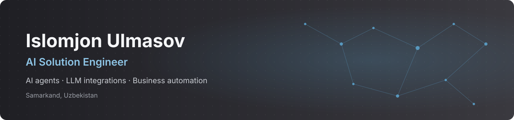

  

  
  
  

I build AI agents, Telegram bots and automations that real businesses in Samarkand use every day: a hotel, a paid parking lot, a clinic and a training centre. Before that I spent two years in QA at Accenture and Cognizant in Riga.

I decide how the system fits together, write the code with Claude Code and Cursor, review what the AI writes and deploy it to my own servers.

## Featured work

<table>
  <tr>
    <td width="50%" valign="top">
      <b><a href="https://helper.bagizagan.com">Zagan</a></b> 
      AI guest assistant for Hotel Bagizagan. Text and voice in three languages, live prices and bookings straight from the Exely PMS.
    </td>
    <td width="50%" valign="top">
      <b>MCP server for Exely PMS</b> 
      FastMCP + OAuth2. I ask questions about 1,000+ reservations in plain language instead of building reports by hand.
    </td>
  </tr>
  <tr>
    <td valign="top">
      <b>Telegram bots</b> 
      Eight bots, six of them internal. <a href="https://t.me/Marokand_humo_bot">@Marokand_humo_bot</a> handles course enrolment so leads don't get lost; <a href="https://t.me/DrAlikulov_bot">@DrAlikulov_bot</a> books prepaid doctor consultations.
    </td>
    <td valign="top">
      <b><a href="https://travel.bagizagan.com">B2B tour constructor</a></b> 
      Travel agents put a tour together step by step, in four languages. FastAPI backend, frontend moving to React.
    </td>
  </tr>
  <tr>
    <td valign="top">
      <b><a href="https://med-online.uz">med-online.uz</a></b> 
      Online consultations and second opinions from doctors in other countries.
    </td>
    <td valign="top">
      <b>Parking automation</b> 
      Hikvision cameras read number plates at Samarkand railway station; per-minute billing, payments, reports and an account for each cashier.
    </td>
  </tr>
  <tr>
    <td valign="top">
      <b>Finance dashboard → CRM</b> 
      Income and expense tracking for a company, now growing into a CRM with contacts, deals and a sales funnel.
    </td>
    <td valign="top">
      <b>AI video editing agent</b> 
      Found the footage, trimmed it and cut a promo video to the beat of the music, with titles, on its own.
    </td>
  </tr>
</table>

## Tech stack

  

**AI and agents:** Claude and GPT models · MCP / FastMCP · n8n · ElevenLabs · Claude Code · Cursor  
**Integrations:** REST APIs · OAuth2 · Telegram Bot API · Exely PMS · Click and Payme · Hikvision ANPR  
**Learning now:** TypeScript · Power BI · ETL/ELT · LangChain and LangGraph · vector databases · CI/CD
